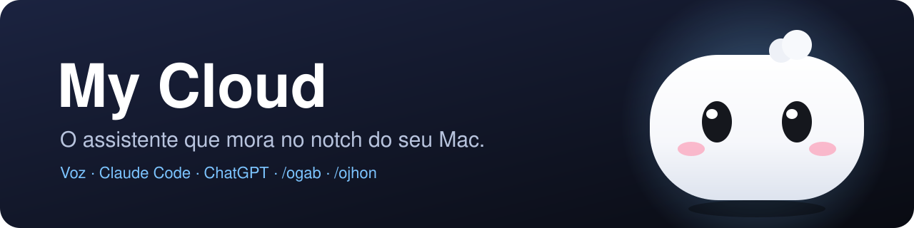
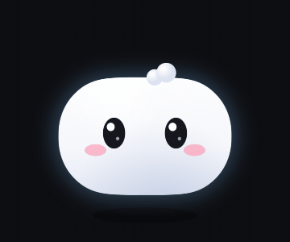
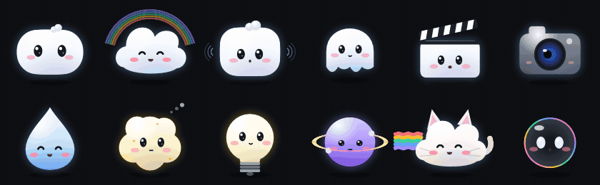
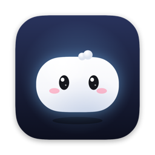

<div align="center">

[](#readme)

[](https://github.com/gabrielxreis/myclaude/commits/main "Histórico")
[](https://claude.com/claude-code "Claude Code")
[](#perguntas-pelo-chatgpt "ChatGPT")
[](#instalacao "Instalação")
[](#desenvolvimento "Desenvolvimento")
[](LICENSE "Licença")

</div>

**My Cloud** é um assistente que mora no notch do seu Mac. Você chama pelo nome ("Ei Cloud", ou o nome que escolher), pede em voz alta e ele faz: abre apps, pesquisa, descarrega o cartão da câmera para o SSD, monta o projeto no DaVinci, responde perguntas e conversa com você. Por trás, ele usa o **Claude Code da sua assinatura** e o **ChatGPT pela sua conta**: nada de chave de API, nada de créditos extras. E ele é um bichinho: tem humor, nível, roupas que mudam com o clima e com as datas festivas, e reage ao que você está fazendo.

<div align="center">



<sub><b>Bolinho</b>, o personagem padrão: parado, ouvindo (pulinho e olhar para a câmera), feliz, pensando e com sono.</sub>

</div>

> **Cada pessoa usa as PRÓPRIAS contas.** O app não traz conta, chave nem login. Ele usa o Claude Code e o Codex que já estão logados no seu Mac. Conversas, atalhos e configurações ficam no seu computador.

* [O QUE ELE FAZ](#o-que-ele-faz)
    * [Voz e conversa contínua](#voz-e-conversa-continua)
    * [Ações instantâneas](#acoes-instantaneas)
    * [Usar qualquer app](#usar-qualquer-app)
    * [Cartão de memória](#cartao-de-memoria)
    * [Chat no notch e histórico](#chat-no-notch-e-historico)
    * [Perguntas pelo ChatGPT](#perguntas-pelo-chatgpt)
    * [Skills: /ogab e /ojhon](#skills-ogab-e-ojhon)
* [PERSONAGENS](#personagens)
* [INSTALAÇÃO](#instalacao)
* [CONFIGURAÇÃO](#configuracao)
    * [Permissões](#permissoes)
    * [O que o Cloud pode fazer](#o-que-o-cloud-pode-fazer)
* [PRIVACIDADE](#privacidade)
* [DESENVOLVIMENTO](#desenvolvimento)
* [CRÉDITOS](#creditos)

<a id="o-que-ele-faz"></a>
# O QUE ELE FAZ

<a id="o-ovo"></a>
## O ovo

Na primeira vez que abre, aparece um ovo: você dá um nome ao seu companheiro, escolhe o bichinho e ele **choca** na sua frente. Dali pra frente é ele que mora no notch, atende pelo nome que você deu e cresce com você.

## Rotinas, gatilhos, missões e conquistas

* **Rotinas:** "todo dia às 8h, bom dia", "toda segunda às 9h30, ideias de reels". Pelo painel ou por voz.
* **Gatilhos:** "quando eu disser modo edição, fecha o WhatsApp e abre o DaVinci".
* **Missões do dia e conquistas:** três missões novas por dia, sequência de dias, medalhas e experiência para o bichinho evoluir.
* **Timers e lembretes:** "timer de 10 minutos", "me lembra às 15h de exportar o vídeo".
* **Tela e clipboard:** "que erro é esse?" (ele lê a tela), "grava a tela", "traduz o que eu copiei", "traduz essa página".
* **Vídeo de referência:** "gostei desse vídeo, cria uma ideia em cima dele" com o vídeo aberto no navegador: a /ogab transcreve e escreve um roteiro novo.

<a id="voz-e-conversa-continua"></a>
## Voz e conversa contínua

* **Chamado pelo nome que você escolher.** Em **Ajustes → Assistente** você dá o nome, e o chamado é qualquer saudação + o nome: **Ei, Hey, Oi, OK, Olá, Alô, Fala, Opa ou E aí**. O nome sozinho nunca acorda, então ele não reage quando você só fala *dele* numa frase.
* **Entende o nome do jeito que o Mac escreve.** Ao digitar o nome, ele cria sozinho as variações faladas (Task → Tasque, Tesk…; Cloud → Claudio, Clau…) e compara pelo **som**, não só pelas letras. Se mesmo assim errar, toque em **Ensinar o nome**: você diz o chamado algumas vezes e ele aprende como o Mac escreve.
* **Faz enquanto você fala, do seu jeito.** "Faz o seguinte: abre o YouTube no Chrome, eu quero que você pesquise carros e coloca o mais assistido": ele acha os comandos no meio da fala (abra, pesquise, clique, coloque…) e cada um roda assim que você começa o próximo. O que for instantâneo roda na hora; só o resto vai para o Claude.
* **Palavras em inglês.** Nomes dos apps instalados, dos sites e palavras de interface ("download", "settings", "filter"…) vão como dica para o reconhecedor, que então escreve como você falou.
* **Quando não entende, pergunta.** Faz cara de dúvida, mostra "Não entendi, pode repetir?" e volta a ouvir sozinho.
* **Tocar nele para.** Enquanto ele escuta, um toque no bichinho interrompe.
* **Continua ouvindo.** Depois de cada pedido ele segue escutando, sem novo chamado, até você dizer "obrigado", "valeu", "pode parar" ou ficar uns segundos em silêncio.
* **Sons e animação.** Um "tink" quando começa a ouvir, um "pop" quando termina, e o personagem pula e olha para você enquanto escuta.
* **Só texto ou com voz.** Por padrão a resposta aparece no notch. Se quiser que ele fale, escolha a voz do Mac ou a do ElevenLabs.

<a id="acoes-instantaneas"></a>
## Ações instantâneas

Rodam no próprio app, na hora, sem gastar o plano:

| Você diz | Ele faz |
|---|---|
| "abre o DaVinci", "fecha o Spotify" | abre ou fecha o app (nome aproximado vale: "da Vinci") |
| "abre a pasta Downloads", "abre a pasta Clientes" | abre a pasta no Finder |
| "abre o YouTube", "abre o site globo.com" | abre o site no navegador |
| "pesquisa receita de bolo" | pesquisa no Google |
| "entra no YouTube e pesquisa carros", "pesquisa fone na Amazon" | pesquisa **dentro do site** (YouTube, Amazon, Mercado Livre, Wikipédia, Spotify, Maps…), na mesma aba |
| "coloca o vídeo mais assistido de carros" | busca no YouTube por visualizações e abre o primeiro |
| "clica em Filtros", "clica no primeiro vídeo" | clica no botão ou link com esse nome, em qualquer app ou site |
| "digita bom dia", "aperta enter", "aperta esc" | digita e aperta teclas no app da frente |
| "volta", "recarrega", "rola pra baixo", "nova aba", "fecha a aba", "copia", "cola", "pausa" | atalhos de navegação, abas, edição e vídeo |
| "abre a conversa com a Maria no WhatsApp" | abre a conversa (telefone dos Contatos) |
| "manda mensagem pro João no WhatsApp dizendo que chego às 8" | deixa a mensagem escrita; **você** aperta Enter |

**Web sempre no Chrome** (ou Brave, Edge, Arc, Chromium, Vivaldi, Opera): o Safari esconde as páginas da automação, então "abre o Safari" abre o Chrome. Para clicar **dentro** dos sites, ligue uma vez no Chrome: **Visualização → Desenvolvedor → Permitir o JavaScript do Eventos da Apple**.

<a id="usar-qualquer-app"></a>
## Usar qualquer app

Para o que não é uma ação instantânea ("no Premiere, exporta a sequência em H.264", "no Finder, renomeia a pasta X"), o Claude pode **ver a tela e usar qualquer app**: clicar, digitar, usar menus e conferir o resultado, pelo [Peekaboo](https://github.com/openclaw/Peekaboo) (código aberto, MIT). Liga em **Ajustes → Assistente → Usar qualquer app** (o instalador já deixa pronto se o Mac tiver Node 22+). No modo Só consultar ele só olha. Antes de apagar, enviar, publicar, comprar ou mudar ajustes do Mac, sempre pergunta.

<a id="cartao-de-memoria"></a>
## Cartão de memória

"**Cláudio, descarrega o cartão pro SSD no projeto Casamento Ana**":

1. Acha o cartão sozinho e reconhece a câmera (Sony, Canon, Nikon, GoPro, DJI, Panasonic, Fujifilm).
2. Pergunta na conversa só o que não sabe: câmera, qual SSD, qual pasta (e lembra a última).
3. Cria `SSD/Casamento Ana/Sony/SD1` (o próximo cartão vira `SD2`).
4. Copia **em segundo plano**, com o progresso no notch, em qualquer tela que você estiver.
5. Confere arquivo por arquivo e avisa com notificação. **Nunca mexe no cartão.**

E dá para pedir junto:

* **"nos dois SSDs"**: backup duplo, os dois ao mesmo tempo, os dois conferidos.
* **"com proxy"**: proxies 720p em `SD1/Proxy`.
* **"e transcreve"**: transcrição local (Whisper, grátis, no próprio Mac) em `SD1/Transcricoes`.
* **"e cria o projeto no DaVinci"**: a [/ogab](https://github.com/gabrielxreis/ogab) cria o projeto e monta a timeline.

<a id="chat-no-notch-e-historico"></a>
## Chat no notch e histórico

O balão do notch abre um chat compacto. O botão **Histórico** abre a janela grande com todas as conversas, de voz e digitadas, cada uma retomando o contexto de onde parou. Tocar na resposta que aparece embaixo do notch também abre a conversa.

<a id="perguntas-pelo-chatgpt"></a>
## Perguntas pelo ChatGPT

Perguntas e pesquisas ("quem ganhou o jogo?", "o que é...", "quanto custa...") vão para o **ChatGPT pelo Codex CLI**, logado com a sua conta do ChatGPT: sem API e sem créditos. Pedidos para *fazer* algo ficam com o Claude. Dá para mandar tudo para o Claude nos Ajustes.

<a id="skills-ogab-e-ojhon"></a>
## Skills: /ogab e /ojhon

O My Cloud conversa com duas skills do Claude Code, que são instaladas à parte (cada uma no seu repositório, se você quiser):

* **[/ogab](https://github.com/gabrielxreis/ogab)**: editor de vídeo (DaVinci, Premiere, After Effects, legenda, motions, roteiro, Instagram).
* **[/ojhon](https://github.com/gabrielxreis/ojhon)**: gestor de tráfego (auditoria de anúncios, plano de mídia, criativos, relatórios).

Se estiverem instaladas, as duas aparecem como atalhos no notch, e pedidos de vídeo e de anúncio vão direto para elas. Você pode fixar qualquer outra skill instalada como atalho, ou pedir ao Cloud: "cria uma ação rápida que...".

<a id="personagens"></a>
# PERSONAGENS

<div align="center">



</div>

Doze bichinhos, cada um com suas manias, todos com os mesmos humores (ouvindo, pensando, falando, feliz, focado, com sono, carente, surpreso, tonto):

| | |
|---|---|
| **Bolinho** (padrão) | olhos de esfera que seguem o cursor, inclina a cabeça para ouvir, piscada dupla, fica tonto com três cutucadas |
| **Nuvem** | balança quando pensa, garoa quando está carente, arco-íris quando feliz |
| **Marshmallow** | amassa e estica, topete que balança, derrete com sono |
| **Vapor** | flutua, fica translúcido quando pensa, solta vapor quando se assusta |
| **Claquete** | a ripa abre quando fala e faz "clap" quando fica feliz |
| **Camerazinha** | a lente é o olho, com abertura que muda e "REC" piscando quando ouve |
| **Gotinha** | pinga quando triste, evapora quando dorme |
| **Pipoca** | estoura pipoquinhas quando feliz |
| **Lâmpada** | acende quando pensa ou fica feliz, apaga quando está carente |
| **Planetinha** | anel girando e luas orbitando quando os agentes trabalham |
| **Gatinho de nuvem** | orelhas em pé para ouvir, rabinho, rastro de arco-íris |
| **Bolha de sabão** | furta-cor, estoura e se forma de novo quando se assusta |

**Tamagotchi.** O card do notch mostra o nome, o humor do momento e o nível (Ovo, Filhote, Jovem, Adulto, Mestre), com as barras **Humor** (sobe quando vocês interagem), **Energia** (o que resta do seu plano do Claude) e **Foco** (agentes trabalhando). Ele também vê em qual app você está e sugere algo que consegue fazer ali. **Toque no card** e ele aparece grande numa janela, com a barra de **Fome** e os cuidados: **lanche** (a comida cai e ele mastiga), **brincar**, **carinho** (toque nele), **dormir / acordar**, conversar e missões.

**Toque e botão direito.** Um toque no bichinho e ele leva um susto e pula (três toques rápidos: fica tonto). Com o botão direito, um menu para trocar a skin e o personagem.

**Novidades.** Depois de uma atualização ele fica feliz e pergunta, num balão embaixo do notch: "Quer ver o que eu sei fazer de novo?". Tocando, abre a lista animada do que mudou.

**Skins.** Padrão, cachecol, fone, boina de diretor, óculos escuros e coroa, ou **automática**: cachecol no frio, óculos no calor, garoa quando chove (clima da sua cidade pelo Open-Meteo, grátis) e roupa de festa no Natal, Ano Novo, Carnaval, Páscoa, Festa Junina, Dia das Crianças e Halloween.

<a id="instalacao"></a>
# INSTALAÇÃO

Dois cliques em **`Instalar My Cloud.command`**. Ele:

1. Confere o **Claude Code** (instala se faltar) e o login da sua assinatura, porque o My Cloud funciona por ele.
2. Baixa o **app pronto** (última release), apaga a versão antiga e instala em **Aplicativos**. Não precisa de Xcode.
3. Adiciona o **Peekaboo** ao Claude Code (usar qualquer app), se o Mac tiver Node 22+.
4. Abre o My Cloud.

Ele instala só o My Cloud: nada de skills nem outros apps junto.

**Na primeira abertura**, depois do ovo, ele pede as permissões **uma depois da outra** (microfone, fala, contatos, calendário, controlar o Chrome e o Terminal) e no fim mostra só o que você precisa ligar à mão:

* **Acessibilidade** e **Gravação de tela** para o My Cloud, nos Ajustes do Sistema (depois, reabra o app).
* **Chrome:** Visualização → Desenvolvedor → Permitir o JavaScript do Eventos da Apple.
* **Claude:** em Ajustes → Claude, **Conectar ao Claude** faz o que faltar (login, sessões no notch, uso do plano) e mostra antes de gravar qualquer coisa.
* **ChatGPT (opcional):** `brew install --cask codex` e `codex login` com a sua conta.

**Atualização automática.** Uma vez por dia o My Cloud confere as releases deste repositório: se tiver versão nova, ele baixa o app pronto, troca a versão em Aplicativos e avisa. Só o app é atualizado. Dá para desligar ou verificar na hora em **Ajustes → Geral → Atualizações**.

**Requisitos:** macOS 15 ou mais novo e assinatura do Claude (Pro ou Max). Xcode só para quem quiser compilar.

> Use o **instalador**. Se você baixar o `MyCloud.zip` pelo navegador, o macOS pode avisar que o desenvolvedor não foi identificado (o app ainda não é notarizado pela Apple); nesse caso, botão direito no app → Abrir. Para o cartão de memória com proxies e transcrição: ffmpeg e Whisper local (a /ogab instala os dois, se você usar).

<a id="configuracao"></a>
# CONFIGURAÇÃO

Tudo em **Ajustes**:

* **Claude:** conexão (Claude Code, conta, sessões no notch, uso do plano), o botão Conectar ao Claude e o que aparece quando uma tarefa termina.
* **Geral:** atualizações, comportamento da ilha, tela (e o tamanho em Mac sem notch), atalho e idioma.
* **Personagem:** o bichinho, a skin, a cidade do clima, os sons e os widgets.
* **Assistente:** o nome (com as variações e o **Ensinar o nome**), o que o Cloud pode fazer, usar qualquer app (Peekaboo), quem responde perguntas e os modelos do Claude.
* **Voz e microfone:** o microfone (ou o padrão do Mac, com aviso se o escolhido estiver desconectado), o idioma e se ele fala ou só escreve.
* **Permissões:** o que já está permitido e o que falta.
* **Dados:** pasta de dados, log e apagar o histórico.

<a id="permissoes"></a>
## Permissões

A aba **Permissões** lista tudo o que o My Cloud usa, para que serve e se está liberado: microfone, reconhecimento de fala, acessibilidade, gravação de tela, contatos, calendário, controlar Terminal, Chrome e Safari, e o JavaScript do Chrome. Cada item tem **Permitir** (pede na hora) ou **Abrir Ajustes** (vai direto ao lugar certo), e **Configurar tudo agora** refaz a sequência. Quando o macOS só libera depois de reabrir, aparece o botão **Reabrir o My Cloud**.

<a id="o-que-o-cloud-pode-fazer"></a>
## O que o Cloud pode fazer

As ações instantâneas sempre funcionam. Para o resto, o Cloud usa o Claude Code em um destes modos:

| Modo | O que acontece |
|---|---|
| **Só consultar** | lê arquivos e pesquisa, não executa nada |
| **Lista de ações** (padrão) | só usa o que está na lista (regras de permissão do Claude Code, editáveis, com guia e exemplos). Fora da lista, ele não faz e avisa |
| **Automático** | modo automático do Claude Code: executa sozinho o que for seguro e bloqueia o arriscado. Vem desligado, com aviso, e só você liga |

Em qualquer modo, ele nunca apaga, publica ou envia mensagem sem você confirmar.

<a id="privacidade"></a>
# PRIVACIDADE

* Sem telemetria e sem conta do My Cloud.
* A voz é reconhecida **no próprio Mac**; só o texto do pedido vai para o Claude ou o ChatGPT, pelas suas contas.
* Conversas, atalhos e configurações ficam em `~/Library/Application Support/MyCloud`.
* Rede, só para o que você usa: Claude, ChatGPT e o clima (Open-Meteo).

<a id="desenvolvimento"></a>
# DESENVOLVIMENTO

```bash
cd NotchBuddy && xcodegen
../scripts/build-mycloud.sh
```

* `scripts/build-mycloud.sh`: compila, assina com identidade estável (o macOS guarda as permissões entre versões), troca a versão em Aplicativos e abre.
* `scripts/render-cloud.swift`: desenha os personagens em PNG e GIF (vitrine, ícone, quadros).
* `scripts/make-cloud-sounds.py`: gera os 29 sons originais do app.

O código Swift do app fica em `NotchBuddy/Sources/App`. Os personagens estão em `CloudPainter.swift`, o cérebro em `Voice/ClaudeCLIBrain.swift` e `Voice/ChatGPTBrain.swift`, e as ações locais em `Voice/CloudLocalActions.swift` e `Voice/CardOffload.swift`.

<a id="creditos"></a>
# CRÉDITOS

O My Cloud nasceu de um fork do **[Coucou](https://github.com/Louis-CFM/coucou)**, de Louis Raillé, cujo código é MIT. O nome Coucou, o personagem Mochi, os sons e as imagens do Coucou pertencem ao autor e **não fazem parte deste repositório**: o My Cloud tem personagens, ícone e sons próprios.

<div align="center">



Feito por **Gabriel Reis** · [gabrielxreis.com](https://gabrielxreis.com) · [instagram.com/gabrielxreis_](https://instagram.com/gabrielxreis_)

</div>
